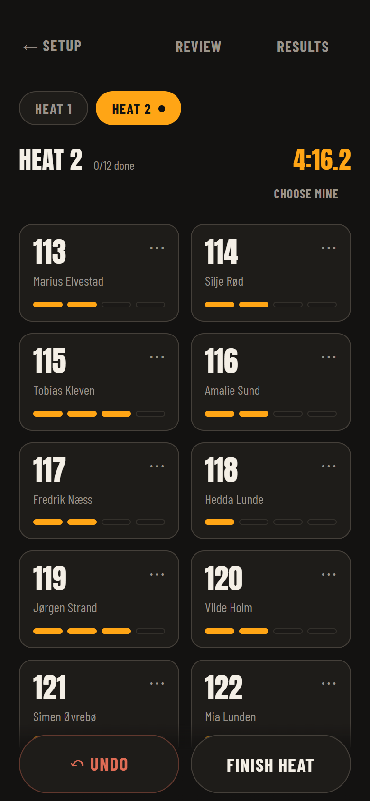
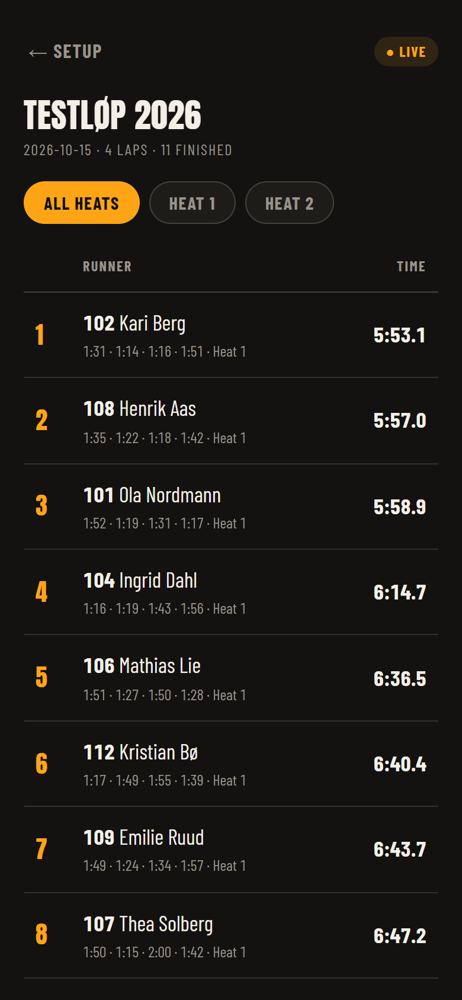
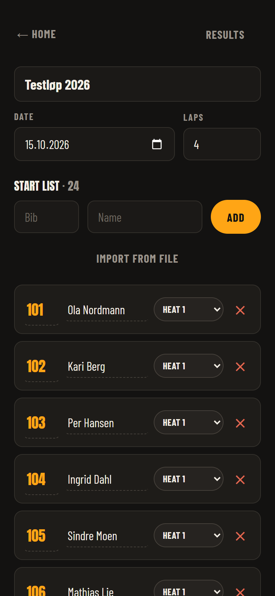

# Beermile Timekeeping

[](https://github.com/JonasHicken/Beermile-Timekeeping/actions/workflows/test.yml)

> **🚧 Still in development.** The core works end to end and runs offline, but
> it has not yet timed a real race. Expect rough edges and breaking changes to
> the data format until it has.

Mobile-first race timing for beer miles. **Tap timing, live results, RFID-ready.**

<p align="center">
  
  &nbsp;
  
  &nbsp;
  
</p>
<p align="center"><sub>Timing a heat &nbsp;·&nbsp; Live results with splits &nbsp;·&nbsp; Start list and heats</sub></p>

## What it's for

A beer mile is four laps of a 400 m track, with a beer finished before each
lap. Races run in heats of 25–30 people starting together, and every runner
needs four lap times and a finish time — plus penalty laps for anyone who
doesn't keep their beer down.

Timing that properly has meant hiring a professional timing crew, which is
expensive for a small volunteer-run event. This app exists to replace that
crew with phones the organisers already own, while ending up just as accurate
and a lot more hands-off.

It was built for the Norwegian championship run by Norges Beermile Forbund,
but nothing in it is specific to one event: any organiser can create a race,
load a start list and time it.

## The idea

Timing is really two problems:

- **The clock** — an exact timestamp when someone crosses the line. Easy, but
  it must be perfect.
- **The identity** — *which* runner crossed. This is the hard part.

Camera and bib-recognition approaches try to solve both at once and fail on
the second: bibs get covered, crumpled and blocked by the runner in front. So
this app splits them. Right now a person is the identity engine — they tap the
runner's tile as they cross — and the tap is the clock. That is reliable today
and needs no hardware.

The data model is designed so that later, an **RFID chip reader** at the line
can replace the person doing the tapping without changing the app. Crossings
land in the same log whether they came from a tap or a chip, so the goal —
fully hands-off timing with per-lap splits — is an added input, not a rewrite.

Underneath that is one rule: **the network is never in the timing path.** A
track rarely has good signal, so every tap is saved on the phone first and
published afterwards. Losing signal mid-heat loses nothing.

## How that shows up in the code

**Local-first:** every tap writes to `localStorage` synchronously, so timing
never waits on the network. Supabase is a downstream publisher, not the source
of truth. A service worker caches the app itself, so it also reloads with no
signal.

**RFID-ready:** the crossings log is append-only with a `source` field
(`tap` | `rfid` | `manual`). An RFID bridge writes crossings with
`source:'rfid'` into the exact same shape, and every screen already
understands them.

**Corrections never delete.** A mis-tap is voided, not removed, so the log
stays auditable and can be reconciled against chip data. Lap numbers are
re-derived from chronological order when read, so voiding one lap renumbers the
ones after it.

## Run locally

```bash
npm install
npm run dev
```

Open the URL Vite prints. Create an event → add runners by hand or **Import from
file** (`.xlsx` / `.csv`) → **Auto-split** into heats → open a heat → **START** →
tap tiles as runners cross → **Results**.

Works offline with zero configuration. Data lives in your browser.

### Tests

```bash
npm test
```

The suite covers the rules a timing app can't get wrong: lap counting and the
duplicate-tap window, voiding a lap and renumbering the ones after it,
penalty laps, standings, start-list import (Norwegian semicolon CSVs, quoted
names, duplicate bibs), persistence across a reload, how shared races
queue and reconcile changes between phones, the admin and timer links,
heat planning, bib blocks and results. It runs on every push.

## Connecting a database (Supabase)

The app needs no server to time a race. Out of the box, with no
configuration, everything lives in the browser of the phone you are using:
start list, heats, tap timing, corrections, results with lap splits, and CSV
export. That is enough for one phone timing one race.

Connecting a database adds the features that need more than one phone.

### What a database adds

| Feature | What it does |
|---|---|
| **Shared races** | Several phones time one race. Taps, heat start/finish and runner status sync between them every couple of seconds. Every tap is saved on the phone first, so a lost signal loses nothing. |
| **Admin and timer links** | The organiser opens the race with an **admin link**; timers get a separate **timer link**. Only the admin link can start, finish or reset a heat. |
| **Timer codes** | A timer link alone opens nothing: each timer also types their name as the admin added them. A link that leaks is useless on its own. |
| **Who times whom** | The admin gives each timer their runners. A timer sees and taps only their own runners and is taken straight to the heat they are timing. |
| **Race admin** | On the admin link: add or remove late runners, build heats (limit per heat, women/men apart, relay teams apart), assign bibs in blocks per class, and split runners between timers. Every change reaches the timers' phones within seconds and can be undone. |
| **Results** | Each runner's fastest lap, a picture of the top three per class to share on social media, and sending finishing times to a records list for approval. |
| **Live results page** | Results update on a public page while the race is running. |

The rules are enforced in the database, not only in the app: a timer link
cannot start a heat or record laps for someone else's runners, however the
request is made.

### Setting it up

1. **Create a Supabase project** at [supabase.com](https://supabase.com). The
   free tier is enough.
2. **Create the tables.** In the Supabase dashboard, open **SQL Editor**,
   paste this repo's [`supabase/schema.sql`](supabase/schema.sql) and run it.
   It is safe to run again, and its tables are prefixed `tk_`, so it can share
   a project with other tables.
3. **Add the race functions.** Shared races, the two links, Race admin and the
   results export are database functions that live in the companion website's
   schema, because that is where races and sign-ups are created: **PART 17**
   (private races) and **PART 18** (live timing) of
   [`supabase/schema.sql` in Beermile-Norge-](https://github.com/JonasHicken/Beermile-Norge-/blob/main/supabase/schema.sql).
   They build on that schema's earlier parts (admins and the results table),
   so run the whole file. Moving them into this repo, so the app can run
   shared races on its own, is on the roadmap.
4. **Point the app at your project.** Copy `.env.example` to `.env` and fill in:

   ```bash
   VITE_SUPABASE_URL=https://<your-project>.supabase.co
   VITE_SUPABASE_ANON_KEY=sb_publishable_...
   ```

   Both are under **Project Settings → API keys** in Supabase. Use the
   **publishable** key only. Never put the secret (service role) key in
   `.env`: anything starting with `VITE_` is built into the app and readable
   by anyone who opens it.
5. **Restart** `npm run dev`. The app now talks to your project.
6. **Hosting it:** build with `npm run build` and serve `dist/` from any
   static host. On Netlify or Vercel, set the same two variables in the
   site's environment settings; they are read at build time.

### Starting a shared race

A race is created on the website side, which hands out its links:

1. Create a private race and link it to timing (in the companion site this is
   `/admin/privatlop`). That creates the timing event and two links,
   `<app address>/join/<event id>#<token>`: an admin link and a timer link.
2. Open the **admin link** on the organiser's phone and tap **Race admin**.
   Make the heats, assign bibs, add the timers by name, give them their
   runners, and share the timer link from there.
3. Each timer opens the **timer link**, types their name and lands on their
   heat. The admin starts the heat; every phone starts with it.

The token sits after the `#`, so it is never sent to a web server or written
to its logs. A phone keeps the race once it has opened the link.

### Is the publishable key safe to ship?

Yes, that is what it is for: every web app that talks to Supabase ships it.
It does not protect the data; the database does. All timing data is reached
through functions that check the admin or timer link (and the timer's name),
and the tables themselves are closed to direct writes. Entrant email is
additionally protected by a column-level grant, because row-level security
alone would not stop the public key reading every entrant's address.

## Roadmap

- [x] Software core: start list, tap timing, laps, undo, live standings (offline)
- [x] Import start lists from Excel / CSV
- [x] Shared races: several phones timing one race
- [x] Admin and timer links, timer codes, Race admin (heats, bibs, late runners, timers)
- [x] Results: fastest laps, top-3 picture to share, export to a records list
- [ ] Shared races without the companion website: the race functions in this repo's schema
- [ ] RFID input module: reader bridge → same crossings log → hands-off + lap splits
- [ ] Drinking-zone splits, multi-operator cross-check

## Structure

| Path | What |
|---|---|
| `src/lib/store.js` | Local-first data model + the append-only crossings log |
| `src/lib/time.js` | Race time formatting / elapsed helpers |
| `src/lib/parseTable.js` | CSV/XLSX parsing, delimiter + column detection |
| `src/lib/online.js` | Shared-race sync loop (outbox out, changes in), links and timer codes |
| `src/lib/heats.js` | Heat planning and splitting runners between timers |
| `src/lib/bibs.js` | Assigning bibs in blocks per class |
| `src/lib/raceResults.js` | Fastest laps, top three per class, times for a records list |
| `src/lib/shareImage.js` | The results picture for social media |
| `src/lib/sync.js` | Supabase publish + public read/realtime (gated on write access) |
| `src/pages/Home.jsx` | Event list / create |
| `src/pages/Setup.jsx` | Start list + heats |
| `src/pages/Timing.jsx` | The tap-timing tile grid (the heart) |
| `src/pages/Review.jsx` | Chronological crossing log + corrections |
| `src/pages/Live.jsx` | Standings + splits |
| `src/pages/Join.jsx` | Joining a shared race from a timing link (and the timer's name) |
| `src/pages/RaceAdmin.jsx` | Race admin on the admin link: start list, heats, bibs, timers, results |
| `test/` | Vitest suite: store, sync and links, heats, bibs, results, file parsing, time |
| `supabase/schema.sql` | `tk_*` tables, RLS (public read, no anon write) |

## Licence

MIT — see [LICENSE](LICENSE). The mascot artwork (`public/logo*` and
`public/mascot-cheer.svg`) is **not** covered by it and remains the property of
its author.

## Third-party

The bundled webfonts (Anton, Barlow Condensed) are licensed under the SIL Open
Font License 1.1; their license texts are in `public/fonts/`.
